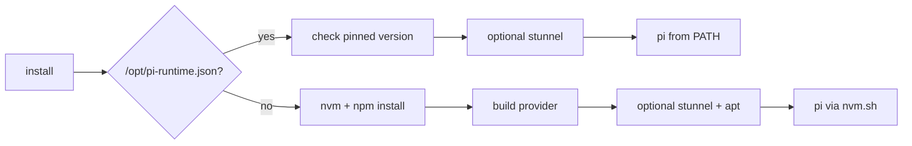

# Harbor Pi Adapter

Harbor adapter for running Pi against Dynamo with one stable Dynamo session per Harbor trial.

## Use

Upstream Harbor's built-in Pi adapter does not install external Pi providers and runs Pi with `--no-session`. `dynamo_pi:DynamoPi` installs the provider from a read-only mount (or uses a [prepared task image](#prepared-task-images)), maps Harbor's per-trial `agent.session_id` to `DYN_AGENT_SESSION_ID`, and closes the session at the trial boundary.

```bash
export PYTHONPATH=/absolute/path/to/agent-plugins/pi-plugin/harbor${PYTHONPATH:+:$PYTHONPATH}

harbor run \
  --agent dynamo_pi:DynamoPi \
  --model dynamo/<model-id> \
  --agent-env DYNAMO_BASE_URL=http://<dynamo-host>:8000/v1 \
  --mounts '[{"type":"bind","source":"/absolute/path/to/agent-plugins/pi-plugin","target":"/opt/pi-dynamo-provider","read_only":true}]'
```

Set `DYN_AGENT_SESSION_FINAL=0` for a plain KV-routing baseline so the terminal control body is not forwarded as model work.

`DYNAMO_CONTEXT_WINDOW` and `DYNAMO_MAX_TOKENS` pass through Harbor's `--agent-env` like the variables above; see the plugin's [Model limits](../README.md#model-limits).

## Prepared task images

By default `install()` runs the upstream Pi installation inside the task container: nvm from GitHub, Node from nodejs.org, Pi and the provider's dependencies from the npm registry. Sandboxes without that egress can bake the runtime into the task image instead and record it in `/opt/pi-runtime.json`:

```json
{"node": "v22.23.4", "pi": "0.72.1", "provider": "/root/pi-dynamo-provider", "extension": "/root/pi-dynamo-provider/dist/index.js"}
```

Only `pi` is read; the other keys document what the image build produced. When the marker exists the adapter skips the installation, uses the recorded version as the agent version, and runs `pi` straight from `PATH`, so the image must expose `node` and `pi` to non-interactive shells (for example through `/usr/local/bin` symlinks) and must have run `pi install` on the built provider. A job that pins a different Pi version than the image records fails before the trial starts. Without the marker the adapter logs a warning and falls back to the egress-dependent installation.



## Tool events through TLS

The provider publishes tool events over plain ZMQ (`DYN_REQUEST_TRACE_TOOL_EVENTS_ZMQ_ENDPOINT`). When the sandbox egress forwards only HTTP and TLS, set `DYN_REQUEST_TRACE_TOOL_EVENTS_STUNNEL_CONFIG` to the path of a stunnel client configuration inside the container. The adapter starts `stunnel` with it as root before the trial, and the provider connects to the local port it listens on. A prepared image must include the `stunnel4` package; the fallback installation path installs it with apt.

## Host networking

Large local-Docker runs should pass [`host-network.yml`](host-network.yml) with Harbor's `--extra-docker-compose` option to avoid creating one bridge network per trial:

```bash
harbor run \
  --extra-docker-compose /absolute/path/to/agent-plugins/pi-plugin/harbor/host-network.yml \
  ...
```

The full Dynamo and SWE-bench launch sequence is documented in Dynamo's ThunderAgent guide.
